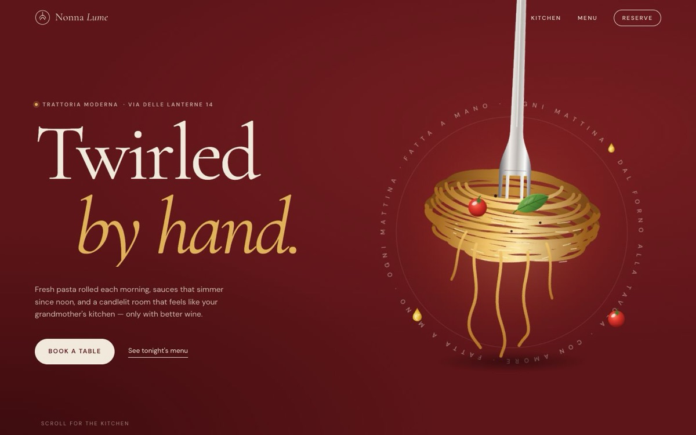

# Nonna Lume — Trattoria

[](https://tabishhassan5121472.github.io/nonna-lume-trattoria/)


An editorial, candlelit landing page for a fictional modern Italian trattoria, where every visual is drawn in code.

**Live demo:** [https://tabishhassan5121472.github.io/nonna-lume-trattoria/](https://tabishhassan5121472.github.io/nonna-lume-trattoria/)

## Techniques
- **Hero:** a hand-built SVG fork twirling a procedurally generated spaghetti nest (22 strand rows split into back and front arcs for depth, gradient shading, flowing dash highlights, swinging loose strands) inside a rotating ring of circular `textPath` type.
- **"The ingredient ballet":** a pinned GSAP ScrollTrigger scene. Twenty-nine SVG ingredients (pasta ribbons drawn with stroke-dashoffset, cherry tomatoes, basil, mussels, shrimp, olive-oil drops) fly in from the edges, orbit in a spiral and land on an illustrated plate while a pasta nest draws itself. Captions and chapters 01/02/03 change as you scroll.
- **Menu:** an editorial list with dotted leaders. Hovering a dish shows its illustration in a card that follows the cursor (`gsap.quickTo`).
- **Reservation:** date pills with an elastic sliding indicator, a guest stepper with a rolling number, time slots (some fully booked), and a submit button that morphs into a spinner, then a check mark with an ingredient burst, then a confirmation ticket. Everything stays local; no network request is made.
- An SVG `feTurbulence` grain overlay, Lenis smooth scrolling, a frosted nav that changes colour per section, and `prefers-reduced-motion` support (shows the plated dish with no pin or loops).

Plain HTML, CSS and JS. GSAP 3.12.5 + ScrollTrigger and Lenis 1.1.13 load from a CDN.


## Run locally

```bash
npx serve .
```

## License

MIT — free to learn from and reuse.
